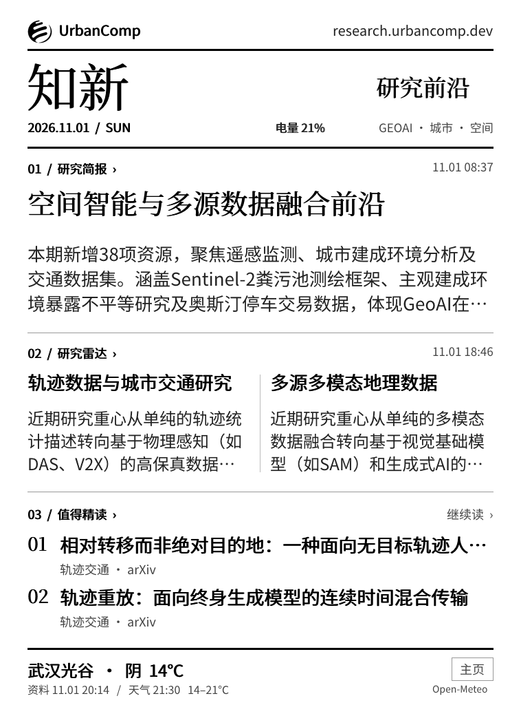
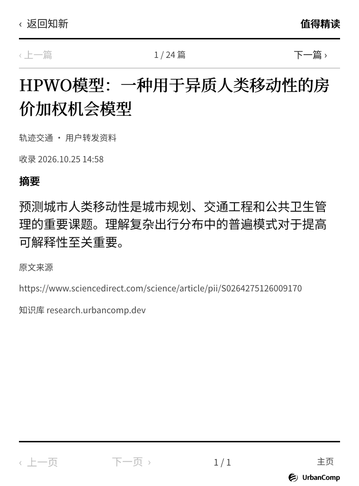
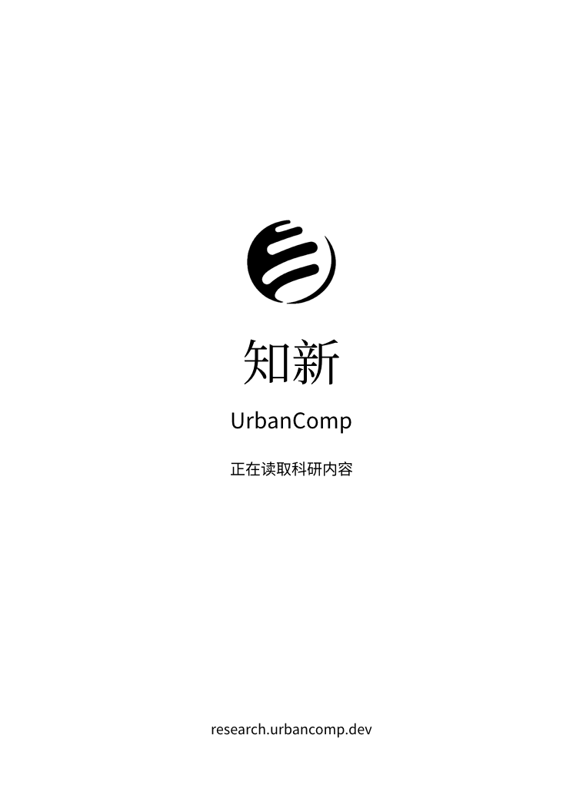

# 知新 · UrbanComp Lab Display

**知新**，一块放在桌边的实验室科研墨水屏。

把 Kindle Paperwhite 2 改造成独立联网的科研信息屏：开机自动显示研究简报、科研雷达、精选论文和武汉光谷天气，每半小时检查更新。保留 Kindle 底层系统与驱动，由原生程序接管屏幕；日常运行不需要浏览器，也不依赖 Mac 开机。

知识库：**[research.urbancomp.dev](https://research.urbancomp.dev/)** · 品牌：**UrbanComp** · 应用版本：**0.5.4**

**项目状态：实验性。**目前仅在 PW2 / 5.12.2.2 上完成硬件验证；其他型号需先验证显示与恢复能力。

## 界面



**实机保存的屏幕画面**，来自 2026-11-01 的 PW2 运行记录。758 × 1024 像素；这是设备 framebuffer 输出，不是拍摄照片。右下角“主页”可返回 Kindle 书库。

 

论文阅读页与品牌启动页为 **0.5.3 电脑渲染样张**，展示布局；0.5.4 延续该品牌设计。截图内容与天气是当时的快照。

## 已实现

- 开机进入“知新”，通过 HTTPS 直接读取 UrbanComp 公开科研接口及 Open-Meteo 天气。
- 每 30 分钟检查更新；断网保留缓存，栏目展示源数据日期。
- 标题点按进入详情，支持论文翻页、下一篇、继续阅读及返回信息屏。
- 以 UrbanComp 标志、中文刊名和知识库网址构成统一品牌识别。
- 首页电量显示；空闲两分钟关闭前光，点击恢复；低至 20% 退出常驻并恢复系统界面。
- USB 维护、主页退出、异常退出时恢复受控的系统界面与电源设置；保留退出原因及运行指标。

## 验证范围

| 项目 | 实测结果 |
| --- | --- |
| 设备 | Kindle Paperwhite 2，4 GB，758 × 1024 |
| 系统 | 固件 5.12.2.2，ARMv7，Linux 3.0.35 |
| 连续断电运行 | **26 小时**，2026-10-31 19:40 至 11-01 21:40（北京时间） |
| 电量 | 98% → 21%，随后在 20% 按策略退出 |
| 更新 | **53 / 53 次成功**，显示失败 0 次 |
| 稳态内存 | RSS 30,984–32,176 KiB |
| 应用 CPU 占用 | 该观察段平均 1.859% |

这是单台设备的一次完整运行观察，不代表所有 Kindle 的兼容性或续航。没有把充电时间、重启后的不同会话拼接成“一天”。[测试报告与复核方法](docs/TESTING.md) · [脱敏实测数据](docs/validation/26h)

## 从哪里开始

1. 阅读 [安装、更新与恢复](docs/INSTALLATION.md)，确认设备和已有越狱环境符合条件。
2. 按 [开发与构建](docs/DEVELOPMENT.md) 编译，得到 `dist/Kindle-UrbanComp-Lab-Display-pw2.zip`；GitHub Actions 成功运行后也会保存安装包 artifact。
3. 先做原生显示测试，再安装开机服务。安装脚本只接受已验证的 PW2 固件和 FBInk 驱动。

本仓库没有 Android 固件镜像，也不包含越狱工具、设备账户、完整固件备份或 research 平台私有后端源码。它保存的是这次改造的客户端与可复现流程。

## 仓库结构

```text
native/app/                   Go 原生客户端、内嵌品牌素材、单元测试
native/package/documents/     Kindle 书库启动、测试、安装、更新、移除脚本
native/package/urbancomp-ink/  启动监管、恢复脚本、中文字体、CA 证书
native/diagnostics/           安装前检查脚本
native/tests/                 电源分析、监管与恢复回归测试
native/build.py               固定工具链构建、校验清单与安装包
native/analyze_metrics.py     连续断电运行分析
ink/                         最初的 Python 浏览器原型（可选）
tests/                       原型测试与桌面浏览器模拟
fixtures/                    原创合成测试示例与生成脚本
docs/images/                 README 截图
docs/validation/26h/          脱敏实机指标与结果
```

## 文档

- [改造过程与版本演进](docs/HISTORY.md)：从浏览器原型到原生常驻，问题、修复与验证。
- [系统架构](docs/ARCHITECTURE.md)：取数、排版、显示、触控、监管和恢复。
- [安装与恢复](docs/INSTALLATION.md)：硬件前提、逐步操作、维护和卸载。
- [开发与构建](docs/DEVELOPMENT.md)：工具链、离线测试、预览、打包。
- [测试与实测报告](docs/TESTING.md)：自动化覆盖、硬件验收、26 小时证据。
- [第三方素材与权利说明](THIRD_PARTY_NOTICES.md)：字体、证书、依赖、实验室标志及内容归属。

## 后续方向

继续积累不同网络与亮度条件下的耗电记录；优化无交互时的唤醒次数；改善长标题、长文和触控反馈；在更多固件上先验证恢复能力，再讨论兼容扩展。当前安装限制不应通过删除检查来绕过。

## 开源与参与

原创代码、文档与合成测试数据采用 [MIT 许可](LICENSE)。**UrbanComp 标志与名称不在 MIT 授权范围内**；字体、CA 证书和截图中的第三方内容按 [各自的权利说明](THIRD_PARTY_NOTICES.md) 使用。

欢迎提交 Issue 或 Pull Request，见 [参与改进](CONTRIBUTING.md)。[合成数据说明](fixtures/README.md) 与 [公开版整理记录](docs/PUBLIC_RELEASE.md) 区分了演示素材和真实设备测试证据。
