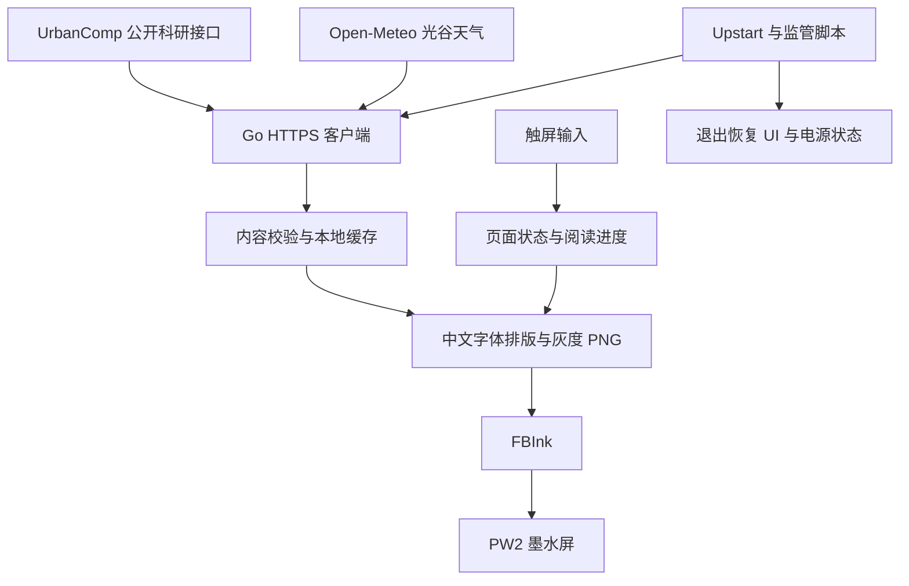

# 系统架构

## 数据与显示路径

Go 程序直接访问 `https://research.urbancomp.dev/api/dashboard`、公开论文列表接口和 Open-Meteo。无账号、Cookie 或 API 密钥。GeoAI、城市计算和轨迹相关的补充列表进入论文选择逻辑。公开接口的可用性与数据格式是外部依赖，平台私有源码不属于此仓库。

天气使用光谷附近坐标 30.51°N、114.40°E，时区 `Asia/Shanghai`。这是区域天气，不是精确到设备位置的观测；不读取定位权限。

## 原生客户端

| 源码 | 职责 |
| --- | --- |
| `content.go`、`selection.go` | HTTPS 取数、字段校验、选文与轮换 |
| `render.go`、`brand.go` | 758 × 1024 灰度排版，内嵌实验室标志 |
| `reader.go`、`ui.go`、`progress.go` | 详情页、翻页、下一篇与继续阅读 |
| `touch*.go` | Linux 输入事件及点按识别，区分滑动与长按 |
| `light.go`、`telemetry.go` | 前光控制、电量与 CPU / 内存指标 |
| `main.go` | 启动缓存、更新周期、显示与主循环 |

启动优先显示已有缓存；无缓存时有品牌启动页。联网更新后再绘制内容。字体通过固定目录加载，PNG 使用灰度绘制，通过 FBInk 刷到屏幕。数据写入采用临时文件、同步与重命名；请求失败保留可用旧内容，并记录各来源成功状态。

0.5.4 在同一轮请求中复用 TLS 连接，完成后关闭空闲连接；触控用可唤醒的 `select` 等待，最长 5 秒只是无事件时的超时，不是触摸响应必须等待 5 秒。

## 启动监管与退出恢复

`urbancomp-ink.conf` 是项目独占的 Upstart 任务；`run.sh` 检查用户盘、USB 存储状态、电量和固件环境，复制运行所需文件到 `/tmp`，记录接管前 UI / 电源状态，再启动客户端。`restore.sh` 验证 PID 和进程启动标识，只恢复本次接管的进程与设置，支持失败后的再次恢复。

USB 是否可用以 `volumd` 和实际挂载状态判断，不依赖可能残留的 USB 物理连接标志。原生端约每 2 秒检查挂载状态。退出、错误及信号处理路径尽可能恢复界面、休眠策略与原前光亮度。安装时会实际执行一次接管与恢复探测，失败则回滚项目启动配置。

## 存储边界

- Git 中保存源码、字体与授权、证书、原创合成测试示例、选定截图及脱敏性能记录。
- `state/` 包含缓存、阅读进度、运行日志、指标与退出原因，只留在设备；不默认打包上传。
- `backups/` 仅保存启动配置及安装前状态，不包含固件分区备份。
- `ink/` 是早期 Python 浏览器原型。它便于桌面排版与验证，但不参与原生开机模式的运行。
